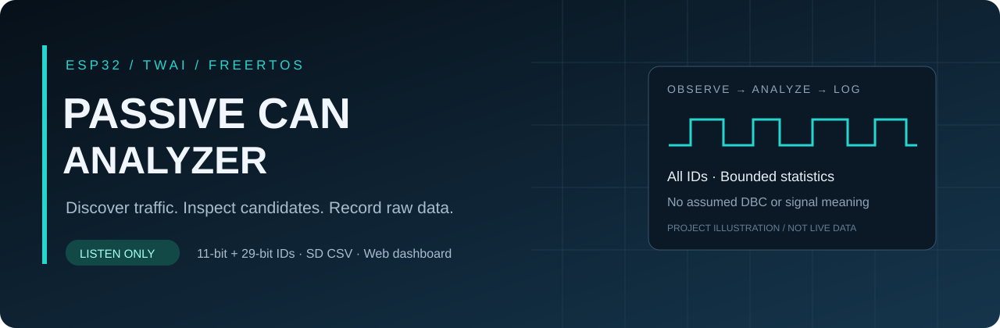
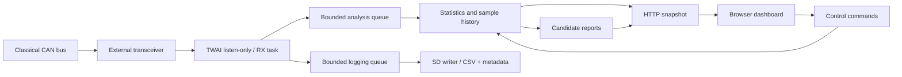

**Language:** English · [ไทย](README_TH.md)

The dashboard and its GitHub Pages demo start in English. Select **ไทย** in the header to switch to Thai; the browser remembers your choice.

<div align="center">



# ESP32 Passive CAN Data Logger Dashboard

**A passive Classical CAN explorer and SD data logger for ESP32, with an embedded web dashboard.**


[](https://github.com/poommyroboticcamera-netizen/DATA-logging-dashboard-CANBUS/actions/workflows/firmware.yml)

[Overview](#overview) · [Features](#features) · [Getting started](#getting-started) · [Hardware map](#hardware-map) · [Data logging](#data-logging) · [Web demo](https://poommyroboticcamera-netizen.github.io/DATA-logging-dashboard-CANBUS/) · [Validation](VALIDATION.md)

<sub>The cover image is an illustration of the project. It is not the result of receiving CAN from the hardware.</sub>

</div>

---

## Overview

PlatformIO project for exploring and recording Classical CAN with ESP32 and external CAN transceiver, with design and workflow from `DATA-Logging-Dashboard-esp32` But it's CAN-only and doesn't have an optional sensor module.

Open the web page via Wi-Fi to view every traffic ID, select the bitrate, check for dropped frames, and start/stop recording CSV to SD without assuming the car brand, DBC, or the meaning of the signal.

The web page is embedded in the firmware and is used with the ESP32 in the local network. In addition, the repository has [Web Demo for ESP32](https://poommyroboticcamera-netizen.github.io/DATA-logging-dashboard-CANBUS/) For experimenting with setting bitrate, turning on/off CAN, starting/stop recording every ID, and downloading CSV without connecting hardware.

## Project at a glance

| Capability | Implementation | Default |
|:--|:--|:--|
| CAN reception | TWAI listen-only, accept all IDs | Driver off at boot |
| Frame formats | Standard / Extended, DATA / RTR | Classical CAN, DLC 0–8 |
| Bitrate | Runtime selection while CAN is off | 500 kbit/s |
| Analysis | Byte/bit statistics and signal candidates | 16 traffic records |
| History | Bounded samples per record | 32 recent frames |
| Operation | Bitrate + CAN on/off + CSV start/stop | Operator controlled |
| Recording | Independent queue → SD task → CSV | Started by operator |
| Interface | Embedded web dashboard and Serial | Wi-Fi / 115200 baud |

## Features

| Traffic discovery | Candidate analysis | Capture and diagnostics |
|:--|:--|:--|
| Standard 11-bit and Extended 29-bit IDs | Bit, 8/16/24/32-bit field hypotheses | Asynchronous raw SD CSV |
| DLC, count, first/last seen and periods | Intel / Motorola interpretations | Baseline and experiment comparison |
| Byte range, mean, variance and changes | 2/4/8/16-bit rolling counters | Driver state and last-frame age |
| XOR masks and bit toggles | Checksum / CRC-location evidence | Queue drops and database-full counts |

## System architecture



CAN RX is the highest priority task in the analyzer's work group and does not wait for SD writing or display. The data analysis and logging section uses a limited queue size. Finding an ID does not mean that a single ECU has been found.

## Safety contract

- CAN driver doesn't work at boot
- Open from the CAN Analyzer page or the Serial command. `CAN ON`
- TWAI is also installed. `TWAI_MODE_LISTEN_ONLY` only
- The transmit queue is zero and the firmware is none. `twai_transmit()`
- There are no commands to send frames, diagnostic requests, or change to active mode.
- Only Classical CAN is supported, CAN FD is not supported.

Firmware passivity does not replace hardware safety: check transceiver model, logic voltage, standby/silent pin, TX/RX, ground, bitrate, and boot/reset behavior before actually connecting the vehicle.

## Hardware map

| Connection | ESP32 GPIO | Purpose |
|:--|:--|:--|
| Transceiver D / TXD | 25 | TWAI TX connection |
| Transceiver R / RXD | 26 | TWAI receive input |
| SD CS | 5 | Card select |
| SD SCK / MISO / MOSI | 18 / 19 / 23 | SPI storage |

Check the wiring to match the actual board. The default value is in [Config.h](src/can/Config.h)

- CAN TX: GPIO25
- CAN RX: GPIO26
- Bitrate: 500 kbit/s (select 50/100/125/250/500/1000 from web pages while CAN is off)
- SD: CS5, SCK18, MISO19, MOSI23
- Wi-Fi AP: `ESP32-CAN-Logger`
- Password: `passive-can` — Change before actual use.

Fix Wi-Fi that `include/wifi_config.h` If you want the ESP32 to connect to the original 2.4 GHz network as well, if you leave the SSID blank, open the page. `http://192.168.4.1/` Through the AP of ESP32

## Getting started

### 1. Get the project

```sh
git clone https://github.com/poommyroboticcamera-netizen/DATA-logging-dashboard-CANBUS.git
cd DATA-logging-dashboard-CANBUS
```

### 2. Configure Wi-Fi

Before the first build, copy `include/wifi_config.example.h` is `include/wifi_config.h` and then set up your Wi-Fi. The actual value files are excluded from Git.

Windows PowerShell:

```powershell
Copy-Item include/wifi_config.example.h include/wifi_config.h
```

macOS / Linux:

```sh
cp include/wifi_config.example.h include/wifi_config.h
```

### 3. Build and upload

```text
pio run -e esp32dev
pio run -e esp32dev -t upload
pio device monitor -b 115200
```

Build script will include `dashboard/index.html`, CSS and JavaScript are automatically gziped into the firmware, no need to upload additional filesystem.

### 4. Open the analyzer

Open the URL displayed by Serial or connect to the AP of ESP32 and open it. `http://192.168.4.1/` Select **CAN Analyzer → bitrate → turn on CAN** and see the actual number of frames received. After installing the new firmware, refresh the web page with Ctrl+F5.

## Core competencies

- Find Standard/Extended ID, DLC, count, timing and estimated frequency.
- Analyze byte/bit, variance, toggle, signal boundary candidates and endianness.
- Check rolling counter candidates and checksum/CRC bounded field candidates.
- Guided learning: baseline vs. experiment and reported as candidate only
- Save raw CAN to SD asynchronous CSV
- Show driver/queue/database/SD drops clearly
- Use bounded database and history to control RAM

## Data logging

Press **LOG START** when CAN is opened, wait for the recording status and file name, then use **LOG STOP** and wait to close the file before removing the SD.

CSV:

```csv
timestamp_us,id,extended,dlc,d0,d1,d2,d3,d4,d5,d6,d7
```

file name `/can_000001.csv`, `/can_000002.csv` In order, ready `.meta` For RTR and loss counters data, IDs are hexadecimal, timestamps are microseconds, and data bytes are decimal. Fields that do not contain payloads are blank.

Example offline analysis with simulation ID from bench:

```sh
python scripts/analyze_can_csv.py can_000001.csv --id 321 --extended 0 --dlc 8
```

## Repository structure

- `src/main.cpp` — Wi-Fi AP, HTTP API and dashboard page
- `src/can/` — passive TWAI service and analysis algorithms
- `dashboard/` — Responsive web pages and CAN controls
- `scripts/embed_dashboard.py` — Embed web pages into firmware
- `scripts/analyze_can_csv.py` — Analyze checksum hypothesis offline
- `tests/can/` — analysis, offline analyzer and passive-contract tests
- `examples/can_bench_generator/` — transmitter for isolated bench only, do not connect to vehicle.

Repository: https://github.com/poommyroboticcamera-netizen/DATA-logging-dashboard-CANBUS

## Passive analyzer: every ID

The accept-all implementation does not have the encoder or vehicle manufacturer's ID embedded in the filter or decoder.
The table shows raw bytes of Standard 11-bit / Extended 29-bit and DATA / RTR separately.
The same ID number of different types is a different record; RTR has no payload and DLC 0 is a valid frame.
None of the data is automatically interpreted as an encoder, throttle, or physical unit.

The default database stores 16 traffic records and previews 32 historical frames per record.
When full, the statistics of the original record are still updated. and shows the number of frames without a statistics box.
The SD logger receives frames separately from the database, so IDs that exceed capacity can still be recorded, but the queue/SD may experience drops.
The web page shows the most recent snapshot, not every live frame; Store raw CSV to view short events.

## Start earning without using the website

Serial 115200 baud supports LF, CRLF and prefix. `:` such as:

```text
CAN ON
STATUS
IDS
ID 100 STD
BASELINE 10
EXPERIMENT ENCODER_MOVE 10
SUMMARY
LOG START
LOG STOP
CAN OFF
```

Wait for the baseline to end before starting the experiment and wait for the file to close before removing the SD.
`CAN ON` Enter the workspace and request to enable the listen-only driver; wait `LISTENING` Before testing
`STOP` Pauses analysis and transmission of new frames into the log, but also drains the receiver; `START` resume
`CAN OFF` Close the driver and close the log; `RESET` Clears stats and captures, but does not clear loss counters.

The page separates ready-to-drive drivers from actual traffic and reports:

- Number of frames since CAN was last turned on, with STD/EXT/RTR (RTR is already included in STD/EXT)
- Latest frame age; -1 means you haven't received it in this opening round yet.
- REC/TEC, driver start error, bus errors and frames that DLC does not match Classical CAN
- analytical break and full database

The actual received amount comes from the dequeue of TWAI and during the analysis break. Therefore, it may be different from the analyzed number.
errors of driver poll every 100 ms; Before shutting down the driver, there may be errors that haven't been polled yet.
The absence of traffic does not prove that the cable is broken or that the bitrate is wrong, because the transmitter may not be sending yet or the bus is asleep.

## Test your two boards.

1. Firmware from PlatformIO for this project: TX25, RX26, SN65HVD230, 500 kbit/s.
2. The transmitter uses `examples/can_bench_generator/can_bench_generator.ino`: TX25, RX26, 500 kbit/s
3. In a bench circuit that is separate from the car, connect GPIO27 of the transmitter to GND and send. `ENABLE BENCH`
4. Open CAN on the receiver. It should find synthetic IDs 0x321 (both STD and EXT), 0x322, 0x345 and RTR 0x456.
5. press `LOG START` On the receiver, wait at least 10 seconds, then press `LOG STOP` and wait until the status is `STOPPED`
6. Open the SD card on the computer. Then check the files with:

```sh
python scripts/verify_bench_csv.py can_000001.csv
```

result `PASS` Verify that all rows of the CSV are structured correctly, timestamps are not reversed, and that dummy stream 0x321 is found for both STD/EXT, 0x322, 0x345, and at least one frame of RTR 0x456 if shown. `FAIL` Do not assume the logger test has passed.

Bench transmitters use No-ACK because passive receivers do not send ACKs.
encoder file `Documents/Arduino/can/can.ino` Yours uses Normal mode and expects ACK.
It is therefore not an equivalent test pair transmitter when there are only two nodes and the receiver is passive.
We did not change the encoder file or receiver file in Normal mode in Arduino.

RS pin through 10 kΩ down GND of SN65HVD230 is slope control; The receiver still works.
Software listen-only does not protect against driver startup or electrical malfunctions.
Test the hardware on the bench before putting it into the real car.

## Check software

```text
node dashboard/can.test.cjs
node dashboard/can.dom.test.cjs
python tests/can/test_passive_contract.py
python tests/can/test_offline_analyzer.py
pio run -e esp32dev
```

Host C++ tests: compile `src/can/Analysis.cpp` paired with `tests/can/test_analysis.cpp`
and compile `tests/can/test_console.cpp` Separate another executable with C++17
The build and host tests do not verify actual reception from the transceiver or sustained-load throughput.

View build results and testing scope in [VALIDATION.md](VALIDATION.md)

## Project status

Firmware and host tests pass the validation record, while actual transceiver reception, SD stalls, runtime heap and long-term stability still need to be tested on the board. The web page is intended to be used on trusted, unsystematic networks. authentication

Presentation format and dashboard guidelines based on [ESP32 Data Logging Dashboard](https://github.com/poommyroboticcamera-netizen/DATA-Logging-Dashboard-esp32) The contents of this repository describe actual CAN analyzers.

---

<div align="center">
<b>Observe traffic. Preserve evidence. Validate candidates.</b><br>
<sub>ESP32 · Classical CAN · Passive analysis</sub>
</div>
