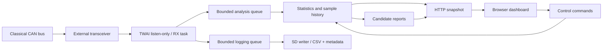

**ภาษา:** [English](README.md) · ไทย

แดชบอร์ดและหน้า GitHub Pages เปิดเป็นภาษาอังกฤษครั้งแรก กด **ไทย** บนหัวหน้าเว็บเพื่อเปลี่ยนภาษา โดยเบราว์เซอร์จะจำค่าที่เลือก

<div align="center">


# ESP32 แดชบอร์ดเครื่องบันทึกข้อมูล CAN แบบพาสซีฟ

**Classical CAN explorer และเครื่องบันทึกข้อมูล SD แบบพาสซีฟสำหรับ ESP32 พร้อมเว็บแดชบอร์ดแบบฝัง**


[](https://github.com/poommyroboticcamera-netizen/DATA-logging-dashboard-CANBUS/actions/workflows/firmware.yml)

[ภาพรวม](#overview) · [คุณสมบัติ](#features) · [เริ่มต้นใช้งาน](#getting-started) · [แผนที่ฮาร์ดแวร์](#hardware-map) · [การบันทึกข้อมูล](#data-logging) · [การสาธิตเว็บ](https://poommyroboticcamera-netizen.github.io/DATA-logging-dashboard-CANBUS/) · [การตรวจสอบ](VALIDATION.md)

<sub>ภาพปกเป็นภาพประกอบโปรเจกต์ ไม่ใช่ผลการรับ CAN จากฮาร์ดแวร์</sub>

</div>

---

## ภาพรวม

โปรเจกต์ PlatformIO สำหรับสำรวจและบันทึก Classical CAN ด้วย ESP32 และ CAN transceiver ภายนอก โดยออกแบบหน้าตาและ workflow จาก `DATA-Logging-Dashboard-esp32` แต่เป็น CAN-only และไม่มีโมดูลเซนเซอร์เสริม

เปิดหน้าเว็บผ่าน Wi-Fi เพื่อดู traffic ทุก ID, เลือก bitrate, ตรวจ dropped frames และสั่งเริ่ม/หยุดบันทึก CSV ลง SD โดยไม่สมมติยี่ห้อรถ, DBC หรือความหมายของ signal

หน้าเว็บถูกฝังใน firmware และใช้งานกับ ESP32 ในเครือข่ายท้องถิ่น นอกจากนี้ repository มี [Web Demo สำหรับ ESP32](https://poommyroboticcamera-netizen.github.io/DATA-logging-dashboard-CANBUS/) สำหรับทดลองตั้ง bitrate, เปิด/ปิด CAN, เริ่ม/หยุดบันทึกทุก ID และดาวน์โหลด CSV โดยไม่ต้องต่อฮาร์ดแวร์

## โครงการได้อย่างรวดเร็ว

| ความสามารถ | การนำไปปฏิบัติ | ค่าเริ่มต้น |
|:--|:--|:--|
| สามารถรับสัญญาณได้ | TWAI Listen-only ยอมรับ ID ทั้งหมด | คนขับออกตอนบูต |
| รูปแบบเฟรม | มาตรฐาน / ขยาย, ข้อมูล / RTR | CAN แบบคลาสสิก, DLC 0–8 |
| บิตเรต | การเลือกรันไทม์ในขณะที่ CAN ปิดอยู่ | 500 กิโลบิต/วินาที |
| การวิเคราะห์ | สถิติไบต์/บิตและตัวเลือกสัญญาณ | บันทึกการจราจร 16 รายการ |
| ประวัติศาสตร์ | ตัวอย่างที่ถูกผูกไว้ต่อบันทึก | 32 เฟรมล่าสุด |
| การดำเนินการ | บิตเรต + เปิด/ปิด CAN + เริ่ม/หยุด CSV | ควบคุมโดยผู้ปฏิบัติงาน |
| การบันทึก | คิวอิสระ → งาน SD → CSV | เริ่มโดย โอเปอเรเตอร์ |
| อินเทอร์เฟซ | เว็บแดชบอร์ดแบบฝังและซีเรียล | Wi-Fi / 115200 บอด |

## คุณสมบัติ

| การค้นพบการจราจร | การวิเคราะห์ผู้สมัคร | การจับภาพและการวินิจฉัย |
|:--|:--|:--|
| รหัสมาตรฐาน 11 บิตและขยาย 29 บิต | บิต, สมมติฐานฟิลด์ 8/16/24/32 บิต | CSV SD ดิบแบบอะซิงโครนัส |
| DLC จำนวน การเข้าชมครั้งแรก/ครั้งสุดท้าย และช่วงเวลา | การตีความของ Intel / Motorola | การเปรียบเทียบพื้นฐานและการทดสอบ |
| ช่วงไบต์ ค่าเฉลี่ย ความแปรปรวน และการเปลี่ยนแปลง | ตัวนับการหมุน 2/4/8/16 บิต | สถานะของผู้ขับขี่และอายุเฟรมสุดท้าย |
| มาสก์ XOR และการสลับบิต | Checksum / หลักฐานตำแหน่ง CRC | คิวลดลงและจำนวนฐานข้อมูลเต็ม |

## สถาปัตยกรรมระบบ



CAN RX เป็น task ความสำคัญสูงสุดในกลุ่มงานของ analyzer และไม่รอการเขียน SD หรือการแสดงผล ส่วนงานวิเคราะห์และบันทึกข้อมูลใช้คิวจำกัดขนาด การพบ ID ไม่ได้หมายความว่าพบ ECU หนึ่งตัว

## สัญญาความปลอดภัย

- CAN driver ไม่ทำงานตอน boot
- เปิดจากหน้า CAN Analyzer หรือคำสั่ง Serial `CAN ON`
- TWAI ถูกติดตั้งด้วย `TWAI_MODE_LISTEN_ONLY` เท่านั้น
- transmit queue เป็นศูนย์ และ firmware ไม่มี `twai_transmit()`
- ไม่มีคำสั่งส่ง frame, diagnostic request หรือเปลี่ยนเป็น active mode
- รองรับ Classical CAN เท่านั้น ไม่รองรับ CAN FD

Firmware passivity ไม่ทดแทน hardware safety: ตรวจรุ่น transceiver, logic voltage, standby/silent pin, TX/RX, ground, bitrate และพฤติกรรมช่วง boot/reset ก่อนต่อรถจริง

## แผนที่ฮาร์ดแวร์

| การเชื่อมต่อ | ESP32 GPIO | วัตถุประสงค์ |
|:--|:--|:--|
| เครื่องรับส่งสัญญาณ D / TXD | 25 | การเชื่อมต่อ TWAI เท็กซัส |
| ตัวรับส่งสัญญาณ R/RXD | 26 | TWAI รับอินพุต |
| เอสดี ซีเอส | 5 | เลือกการ์ด |
| SD SCK / มิโซะ / MOSI | 18 / 19 / 23 | ที่เก็บข้อมูล SPI |

ตรวจ wiring ให้ตรงกับบอร์ดจริง ค่าเริ่มต้นอยู่ใน [กำหนดค่า h](src/can/Config.h)

- สามารถเท็กซัส: GPIO25
- สามารถรับได้: GPIO26
- Bitrate: 500 kbit/s (เลือก 50/100/125/250/500/1000 จากหน้าเว็บได้ขณะ CAN ปิด)
- SD: CS5, SCK18, MISO19, MOSI23
- ไวไฟเอพี: `ESP32-CAN-Logger`
- รหัสผ่าน: `passive-can` — เปลี่ยนก่อนใช้งานจริง

แก้ Wi-Fi ที่ `include/wifi_config.h` หากต้องการให้ ESP32 ต่อเครือข่าย 2.4 GHz เดิมด้วย หากปล่อย SSID ว่าง ให้เปิดหน้า `http://192.168.4.1/` ผ่าน AP ของ ESP32

## เริ่มต้นใช้งาน

### 1. รับโครงการ

```sh
git clone https://github.com/poommyroboticcamera-netizen/DATA-logging-dashboard-CANBUS.git
cd DATA-logging-dashboard-CANBUS
```

### 2. กำหนดค่า Wi-Fi

ก่อน build ครั้งแรก คัดลอก `include/wifi_config.example.h` เป็น `include/wifi_config.h` แล้วตั้งค่า Wi-Fi ของคุณ ไฟล์ค่าจริงถูกยกเว้นจาก Git

วินโดวส์ PowerShell:

```powershell
Copy-Item include/wifi_config.example.h include/wifi_config.h
```

macOS / ลินุกซ์:

```sh
cp include/wifi_config.example.h include/wifi_config.h
```

### 3. สร้างและอัปโหลด

```text
pio run -e esp32dev
pio run -e esp32dev -t upload
pio device monitor -b 115200
```

Build script จะรวม `dashboard/index.html`, CSS และ JavaScript เป็น gzip ใน firmware โดยอัตโนมัติ ไม่ต้อง upload filesystem เพิ่ม

### 4. เปิดตัววิเคราะห์

เปิด URL ที่ Serial แสดง หรือเชื่อมต่อ AP ของ ESP32 แล้วเปิด `http://192.168.4.1/` เลือก **CAN Analyzer → bitrate → เปิด CAN** และดูจำนวนเฟรมที่รับจริง หลังลง firmware ใหม่ให้ refresh หน้าเว็บด้วย Ctrl+F5

## ความสามารถหลัก

- ค้นหา Standard/Extended ID, DLC, count, timing และความถี่โดยประมาณ
- วิเคราะห์ byte/bit, variance, toggle, signal boundary candidates และ endianness
- ตรวจ rolling counter candidates และ checksum/CRC field candidates แบบ bounded
- Guided learning: baseline เทียบกับ experiment และรายงานเป็น candidate เท่านั้น
- บันทึก raw CAN ลง SD แบบ asynchronous CSV
- แสดง driver/queue/database/SD drops อย่างชัดเจน
- ใช้ฐานข้อมูลและ history แบบ bounded เพื่อควบคุม RAM

## การบันทึกข้อมูล

กด **LOG START** เมื่อเปิดรับ CAN แล้ว รอสถานะ recording และชื่อไฟล์ จากนั้นใช้ **LOG STOP** และรอปิดไฟล์ก่อนถอด SD

CSV:

```csv
timestamp_us,id,extended,dlc,d0,d1,d2,d3,d4,d5,d6,d7
```

ไฟล์ชื่อ `/can_000001.csv`, `/can_000002.csv` ตามลำดับ พร้อม `.meta` สำหรับข้อมูล RTR และ loss counters ID เป็นเลขฐานสิบหก ส่วน timestamp เป็น microseconds และ data bytes เป็นเลขฐานสิบ ช่องที่ไม่มี payload จะว่าง

ตัวอย่าง offline analysis ด้วย ID จำลองจาก bench:

```sh
python scripts/analyze_can_csv.py can_000001.csv --id 321 --extended 0 --dlc 8
```

## โครงสร้างพื้นที่เก็บข้อมูล

- `src/main.cpp` — Wi-Fi AP, HTTP API และหน้า dashboard
- `src/can/` — passive TWAI service และ analysis algorithms
- `dashboard/` — หน้าเว็บ responsive และ CAN controls
- `scripts/embed_dashboard.py` — ฝังหน้าเว็บลง firmware
- `scripts/analyze_can_csv.py` — วิเคราะห์ checksum hypothesis แบบ offline
- `tests/can/` — การวิเคราะห์ เครื่องวิเคราะห์ออฟไลน์ และการทดสอบสัญญาแบบพาสซีฟ
- `examples/can_bench_generator/` — transmitter สำหรับ isolated bench เท่านั้น ห้ามต่อรถ

พื้นที่เก็บข้อมูล: https://github.com/poommyroboticcamera-netizen/DATA-logging-dashboard-CANBUS

## Passive analyzer: ทุก ID

การรับใช้ accept-all ไม่มี ID ของ encoder หรือผู้ผลิตรถฝังอยู่ในตัวกรองหรือ decoder
ตารางแสดง raw bytes ของ Standard 11-bit / Extended 29-bit และ DATA / RTR แยกกัน
ID เลขเดียวกันต่างชนิดจะเป็นคนละ record; RTR ไม่มี payload และ DLC 0 เป็นเฟรมที่ใช้ได้
ยังไม่ตีความข้อมูลใดเป็น encoder, throttle หรือหน่วยทางกายภาพโดยอัตโนมัติ

ฐานข้อมูลเริ่มต้นเก็บ 16 traffic records และตัวอย่างย้อนหลัง 32 เฟรมต่อ record
เมื่อเต็ม สถิติของ record เดิมยังอัปเดต และแสดงจำนวนเฟรมที่ไม่มีช่องเก็บสถิติ
SD logger รับเฟรมแยกจากฐานข้อมูล จึงยังบันทึก ID ที่เกินความจุได้ แต่คิว/SD อาจมี drops
หน้าเว็บแสดง snapshot ล่าสุด ไม่ใช่ทุกเฟรมแบบสด; เก็บ raw CSV เพื่อดูเหตุการณ์สั้น ๆ

## เริ่มรับโดยไม่ใช้เว็บ

Serial 115200 baud รองรับ LF, CRLF และ prefix `:` เช่น:

```text
CAN ON
STATUS
IDS
ID 100 STD
BASELINE 10
EXPERIMENT ENCODER_MOVE 10
SUMMARY
LOG START
LOG STOP
CAN OFF
```

รอ baseline จบก่อนเริ่ม experiment และรอไฟล์ปิดก่อนถอด SD
`CAN ON` เข้า workspace และร้องขอเปิด listen-only driver; รอ `LISTENING` ก่อนทดลอง
`STOP` พักการวิเคราะห์และการส่งเฟรมใหม่เข้า log แต่ยัง drain ตัวรับ; `START` เริ่มต่อ
`CAN OFF` ปิด driver และขอปิด log; `RESET` ล้างสถิติและ capture แต่ไม่ล้าง loss counters

หน้าเว็บแยก driver พร้อมรับออกจากการพบ traffic จริง และรายงาน:

- จำนวนเฟรมตั้งแต่เปิด CAN ครั้งล่าสุด พร้อม STD/EXT/RTR (RTR รวมใน STD/EXT อยู่แล้ว)
- อายุเฟรมล่าสุด; -1 หมายถึงยังไม่เคยรับในรอบเปิดนี้
- REC/TEC, driver start error, bus errors และเฟรมที่ DLC ไม่ตรง Classical CAN
- การพักวิเคราะห์ และฐานข้อมูลเต็ม

จำนวนรับจริงมาจากการ dequeue ของ TWAI รวมถึงขณะพักวิเคราะห์ จึงอาจต่างจากจำนวนวิเคราะห์
errors ของ driver poll ทุก 100 ms; ช่วงก่อนปิด driver อาจมี error ที่ยังไม่ได้ poll
การไม่มี traffic ไม่พิสูจน์ว่าสายเสียหรือ bitrate ผิด เพราะตัวส่งอาจยังไม่ส่งหรือ bus หลับ

## ทดสอบสองบอร์ดของคุณ

1. ตัวรับใช้ firmware จาก PlatformIO โปรเจกต์นี้: TX25, RX26, SN65HVD230, 500 kbit/s
2. ตัวส่งใช้ `examples/can_bench_generator/can_bench_generator.ino`: TX25, RX26, 500 กิโลบิต/วินาที
3. ในวงจร bench ที่แยกจากรถ ต่อ GPIO27 ของตัวส่งลง GND และส่ง `ENABLE BENCH`
4. เปิด CAN บนตัวรับ ควรพบ synthetic IDs 0x321 (ทั้ง STD และ EXT), 0x322, 0x345 และ RTR 0x456
5. กด `LOG START` ที่ตัวรับ รออย่างน้อย 10 วินาที แล้วกด `LOG STOP` และรอจนสถานะเป็น `STOPPED`
6. นำ SD มาเปิดบนคอมพิวเตอร์ แล้วตรวจไฟล์ที่ได้ด้วย:

```sh
python scripts/verify_bench_csv.py can_000001.csv
```

ผล `PASS` ยืนยันว่า CSV ทุกแถวมีโครงสร้างถูกต้อง, timestamp ไม่ย้อนกลับ และพบ stream จำลอง 0x321 ทั้ง STD/EXT, 0x322, 0x345 และ RTR 0x456 อย่างน้อยหนึ่งเฟรม หากขึ้น `FAIL` ห้ามถือว่าการทดสอบ logger ผ่าน

ตัวส่ง bench ใช้ No-ACK เพราะตัวรับ passive ไม่ส่ง ACK
ไฟล์ encoder `Documents/Arduino/can/can.ino` ของคุณใช้ Normal mode และคาดหวัง ACK
จึงไม่ใช่ตัวส่งคู่ทดสอบที่เทียบเท่ากันเมื่อมีเพียงสองโหนดและตัวรับเป็น passive
เราไม่ได้เปลี่ยนไฟล์ encoder หรือไฟล์ receiver แบบ Normal mode ใน Arduino

ขา RS ผ่าน 10 kΩ ลง GND ของ SN65HVD230 เป็น slope control; ตัวรับยังทำงาน
Software listen-only ไม่ป้องกันช่วงก่อน driver เริ่มทำงานหรือความผิดปกติทางไฟฟ้า
ทดสอบ hardware บน bench ก่อนนำไปต่อรถจริง

## ตรวจสอบซอฟต์แวร์

```text
node dashboard/can.test.cjs
node dashboard/can.dom.test.cjs
python tests/can/test_passive_contract.py
python tests/can/test_offline_analyzer.py
pio run -e esp32dev
```

การทดสอบโฮสต์ C++: คอมไพล์ `src/can/Analysis.cpp` คู่กับ `tests/can/test_analysis.cpp`
และ compile `tests/can/test_console.cpp` แยกอีก executable ด้วย C++17
การ build และ host tests ไม่ยืนยันการรับจาก transceiver จริงหรือ sustained-load throughput

ดูผล build และขอบเขตการทดสอบใน [การตรวจสอบ.md](VALIDATION.md)

## สถานะโครงการ

Firmware และ host tests ผ่านการตรวจตาม validation record ส่วนการรับจาก transceiver จริง, SD stalls, runtime heap และความเสถียรระยะยาวยังต้องทดสอบบนบอร์ด หน้าเว็บตั้งใจใช้ในเครือข่ายที่เชื่อถือได้และยังไม่มีระบบ authentication

รูปแบบการนำเสนอและแนวทาง dashboard อ้างอิงจาก [แดชบอร์ดการบันทึกข้อมูล ESP32](https://github.com/poommyroboticcamera-netizen/DATA-Logging-Dashboard-esp32) โดยเนื้อหาใน repository นี้อธิบาย CAN analyzer ที่มีอยู่จริง

---

<div align="center">
<b>สังเกตการจราจร. เก็บหลักฐาน. ตรวจสอบผู้สมัคร</b><br>
<sub>ESP32 · CAN แบบคลาสสิก · การวิเคราะห์แบบพาสซีฟ</sub>
</div>
